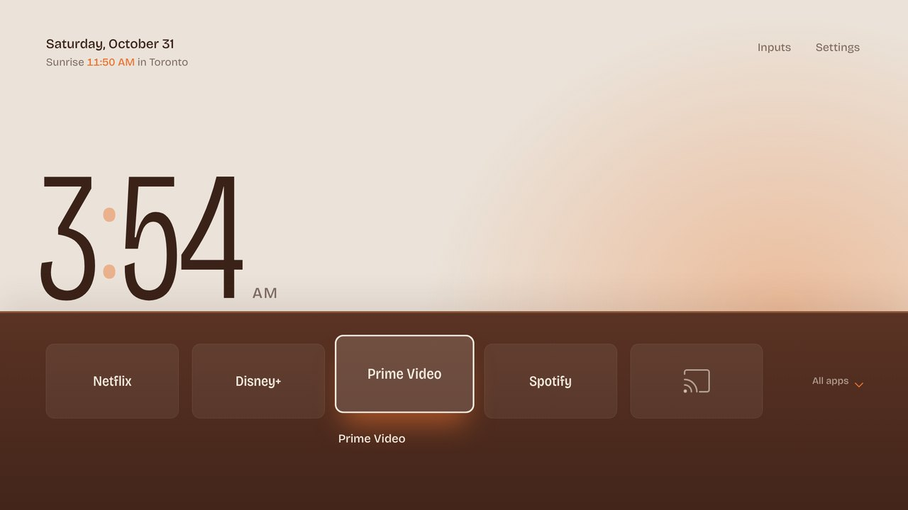
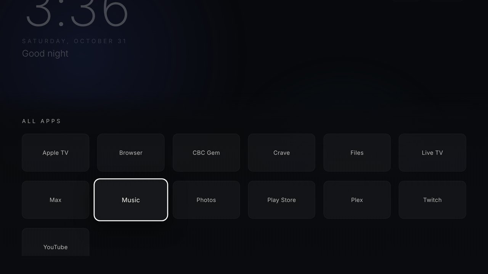
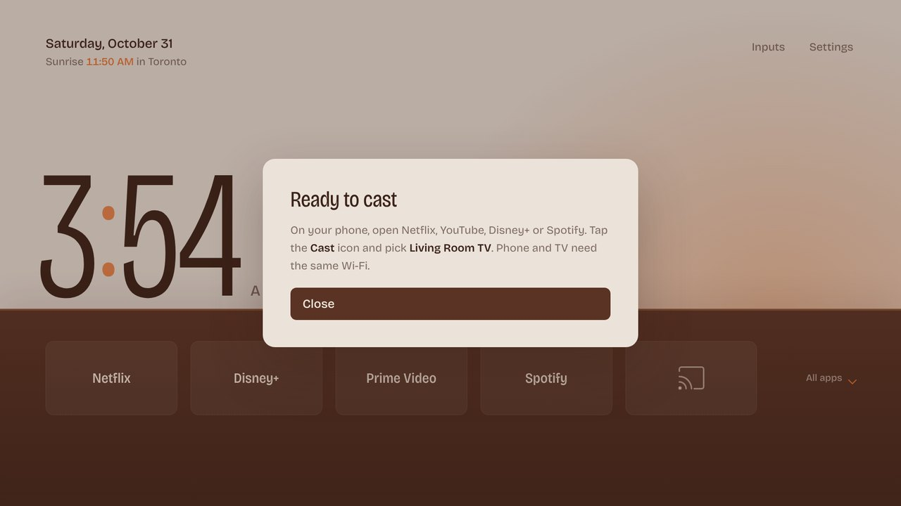

# TV Home

A minimal homescreen for two TVs: a TCL Google TV and a Samsung. One shared design, two installers.



- Paper: your apps as a list of large type on white. No tiles.
- The selected app turns chestnut with an orange dot. The rest stay faint.
- Press Down past the dock and the list continues with every other app in smaller type.
- One warm sun on the right. It warms through the day and sinks and dims at night.
- Time and date top left. Inputs and Settings top right.
- Samsung only: Live TV (the Fire Stick) and Xbox. Each switches the TV to its HDMI port. The first press asks which port, and the TV remembers it. Press Right on the line to change it.
- Gameday (Samsung only): on NFL Sundays from 8 AM, and any day the Cowboys play, the page turns navy and silver, with stadium lights, broadcast stripes and a DALLAS wordmark. A scorebug counts down to kickoff, then shows the live score. It shows the Cowboys game with kickoff, network and venue, or the live score, and the day's full schedule with each game's favorite and moneyline. The Cowboys game also shows both moneylines, the spread and the over/under. Live TV becomes "Watch the game" and names the network to find. Data comes from ESPN's public scoreboard, refreshed every minute. Settings live under `gameday` in `web/config.js`.
- Gameday intro: a 1080p FPV drone shot at golden hour. It races over AT&T Stadium, dives through the roof with fireworks, and follows a quarterback's pass into a slow-motion spiral, with crowd sound. It plays once each time the homescreen opens on gameday. Any button skips it. It streams from Higgsfield's web link in `gameday.intro`; to keep a copy on the TV, save it as `web/intro.mp4` and set `intro: 'intro.mp4'`. For it to play when the TV turns on, open the homescreen app before you turn the TV off and turn on Settings > General > Smart Features > Autorun Last App (most Samsung models).
- Typeface: Bricolage Grotesque, bundled in `web/fonts` (SIL Open Font License).
- No ads, no tracking, no network calls. Everything runs on the TV.

| All apps | Chromecast |
|---|---|
|  |  |

## How it works

| Folder | What it is |
|---|---|
| `web/` | The homescreen UI. HTML, CSS, JS. Both TVs run this. |
| `web/config.js` | Dock apps, clock format, hidden apps. Edit this. |
| `android/` | TCL launcher. A full-screen WebView with a bridge to list and open apps and switch HDMI inputs. |
| `tizen/` | Samsung app manifest and icon. |
| `tools/` | Install and restore scripts. |
| `PROMPT.md` | Prompts to run in Claude Code at home. |

## Install

The easy route: open Claude Code on a computer on your home Wi-Fi, inside this repo, and paste a prompt from [PROMPT.md](PROMPT.md).

By hand:

```bash
# TCL: turn on USB debugging on the TV first (see PROMPT.md)
tools/tcl-install.sh 192.168.1.50
tools/tcl-restore.sh 192.168.1.50            # undo

# Samsung: turn on Developer mode on the TV first (see PROMPT.md)
tools/samsung-install.sh 192.168.1.60 MyCertProfile
```

Preview on a laptop: open `web/index.html` in Chrome. Up and Down move, Enter opens, Esc goes back.

## What each TV allows

| | TCL (Google TV) | Samsung (Tizen) |
|---|---|---|
| Replaces the Home button | Yes | No. Samsung locks Smart Hub. It installs as an app; pin it first in the Apps row. |
| Removes the ad rows | Yes, by disabling the stock home (reversible) | No |
| Live TV and Xbox lines | Hidden. Add `'android'` to `tvs` in `web/config.js` to show them. | Shows the Fire Stick or Xbox HDMI port full screen (depends on the model allowing it). Otherwise opens the input list. Back returns home. |
| Chromecast line | Opens a Chromecast HDMI input if one exists, else shows how to cast to the TV's built-in Chromecast | Shows the Chromecast HDMI input full screen (depends on the model allowing it). Otherwise opens the input list. Back returns home. |
| Settings button | Opens system settings | Hidden. Samsung blocks it. Use the remote. |
| Supported models | Android 7+ | 2019 or newer |

## Change the dock

Edit `web/config.js`, then run the install script again. Android package names for common apps:

| App | Package |
|---|---|
| YouTube | `com.google.android.youtube.tv` |
| Apple TV | `com.apple.atve.androidtv.appletv` |
| Plex | `com.plexapp.android` |

Name your Chromecast's HDMI input "Chromecast" in the TV's input settings and the Chromecast line finds it.

## Credits

Approach informed by open-source projects on GitHub: Gathin23/cleanyourtv, simbasjungles/free-my-tv and mihirgupta0900/tv-home. No code copied.
